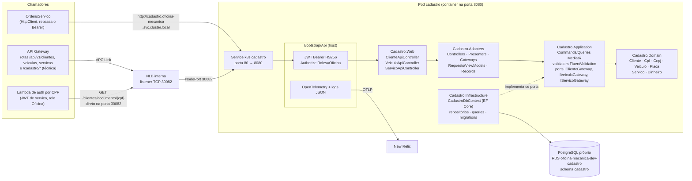
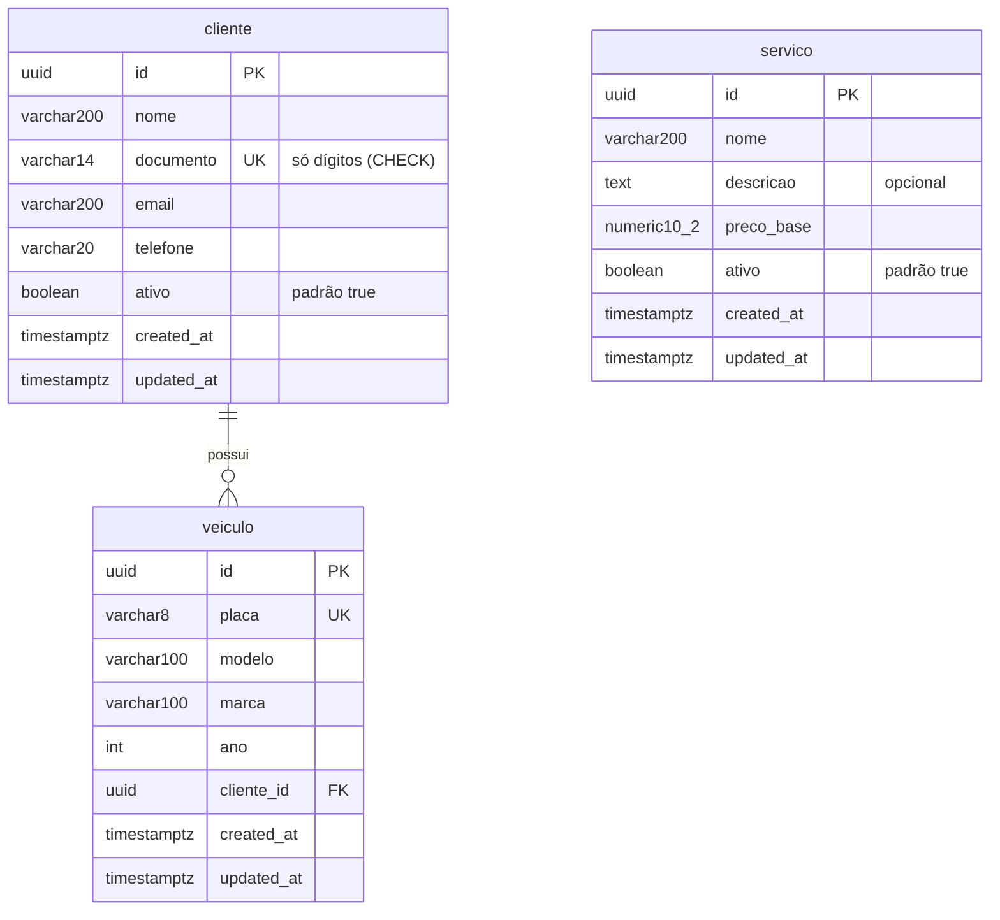

# oficina-mecanica-cadastro

Microsserviço **Cadastro** do sistema de oficina mecânica — Tech Challenge da pós-graduação em
Arquitetura de Software (FIAP/SOAT), **Fase 4**.

É o dono dos dados de **clientes**, **veículos** e **serviços** da oficina, com banco PostgreSQL
próprio. Foi extraído do módulo `Cadastro` do monólito original e mantém Clean Architecture
(`Domain` → `Application` → `Adapters` → `Infrastructure`/`Web`), com o host em `src/Bootstrap/Api`.

## Índice

- [Propósito e responsabilidade](#propósito-e-responsabilidade)
- [Arquitetura do serviço](#arquitetura-do-serviço)
- [Tecnologias](#tecnologias)
- [Pré-requisitos](#pré-requisitos)
- [Execução local](#execução-local)
- [Configuração](#configuração)
- [API](#api)
- [Banco e modelo de dados](#banco-e-modelo-de-dados)
- [Testes e cobertura](#testes-e-cobertura)
- [Pipeline de CI/CD](#pipeline-de-cicd)
- [Deploy no EKS e limitação da AWS Academy](#deploy-no-eks-e-limitação-da-aws-academy)
- [Observabilidade](#observabilidade)
- [Repositórios do sistema](#repositórios-do-sistema)

---

## Propósito e responsabilidade

- Cadastrar, consultar e manter **clientes** (pessoa física com CPF ou jurídica com CNPJ),
  **veículos** (vinculados a um cliente) e o **catálogo de serviços** da oficina (nome, descrição e
  preço base).
- Ser a **única fonte** do dado de cliente, veículo e serviço: nenhum outro serviço acessa o banco do
  Cadastro. Quem precisa do dado o consulta por HTTP.
- Responder à **Lambda de autenticação por CPF** (`oficina-mecanica-lambda-auth`) se um documento
  pertence a um cliente existente e ativo — rota `GET /api/v1/clientes/documento/{documento}`.

O serviço **não publica nem consome eventos** de mensageria: ele só expõe HTTP e persiste no próprio
PostgreSQL. Por isso não depende de SQS/SNS nem do LocalStack.

## Arquitetura do serviço



A **Regra de Dependência** é forçada por referências de projeto: `Domain` referencia só o
`SharedKernel.Domain`; `Application` referencia só `Domain` e o `SharedKernel.Application`;
`Adapters` referencia `Application` e `Domain`; `Web` referencia `Adapters`; e `Infrastructure`
referencia todos os anteriores para implementar os *ports*. A `Application` define os *ports*
(`IClienteGateway`, `IVeiculoGateway`, `IServicoGateway`) e não conhece EF Core, ASP.NET nem
`HttpClient`. Os repositórios EF e o `CadastroDbContext` ficam em `Infrastructure`; o host
(`Bootstrap/Api`) compõe tudo.

| Camada | Projeto | Conteúdo |
|---|---|---|
| Domain | `Cadastro.Domain` | Agregados `Cliente`, `Veiculo`, `Servico`; objetos de valor `Cpf`, `Cnpj`, `Placa`, `Dinheiro`; regras de validade (e-mail, telefone, placa, ano, preço) |
| Application | `Cadastro.Application` | Casos de uso como commands/queries (MediatR) com *behaviors* de log, validação (FluentValidation) e transação; `Result`/`Error`; ports dos gateways |
| Adapters | `Cadastro.Adapters` | Controllers de Clean Architecture, Presenters, ViewModels/Requests, Gateways (adaptam repositório → port) e `Records` de persistência |
| Infrastructure | `Cadastro.Infrastructure` | `CadastroDbContext`, configurações EF, repositórios, queries de listagem, migrations, `AddCadastroModule` |
| Web | `Cadastro.Web` | Controllers ASP.NET (`[Authorize(Roles = "Oficina")]`) que traduzem `Result` em status HTTP |
| Host | `src/Bootstrap/Api` | `Program.cs`, autenticação JWT, OpenAPI/Scalar, health checks, observabilidade, tratamento de exceções |
| SharedKernel | `src/SharedKernel` | `Result`, `Error`, `AggregateRoot`, behaviors e infraestrutura de eventos do monólito (cópia; sem uso neste serviço, que não tem eventos) |

## Tecnologias

| Tecnologia | Uso |
|---|---|
| .NET 10 / ASP.NET Core | API REST em controllers |
| MediatR 12 + FluentValidation 11 | Casos de uso e validação de entrada |
| EF Core 10 + Npgsql | Persistência em PostgreSQL; migrations aplicadas na inicialização |
| DocsBRValidator | Validação de CPF/CNPJ |
| JWT Bearer (HS256) | Autenticação por segredo compartilhado entre os serviços |
| OpenAPI nativo + Scalar | Contrato (`/openapi/v1.json`) e UI interativa (`/scalar`) |
| OpenTelemetry (OTLP) | Traces, métricas e logs → New Relic (Jaeger local) |
| xUnit v3, Moq, Testcontainers | Testes unitários e de integração (PostgreSQL real) |
| Docker, Kubernetes (EKS), GitHub Actions | Empacotamento, deploy e pipelines |

## Pré-requisitos

- .NET SDK 10 e Docker (Compose v2).
- Para a execução local completa: o repositório
  [`oficina-mecanica-app`](https://github.com/gabrielMauad/oficina-mecanica-app) clonado, pois é ele
  quem mantém o `docker-compose.infra.yml` (rede Docker `oficina-local` e Jaeger).

## Execução local

```bash
# 1. no repositório oficina-mecanica-app: cria a rede oficina-local e sobe LocalStack + Jaeger
docker compose -f docker-compose.infra.yml up -d

# 2. neste repositório: sobe o Cadastro e o PostgreSQL próprio
docker compose up --build
```

| Item | Valor |
|---|---|
| API | <http://localhost:8082> (a raiz redireciona para o Scalar em `/scalar`) |
| OpenAPI | <http://localhost:8082/openapi/v1.json> |
| PostgreSQL | `localhost:5433`, database `cadastro`, usuário `oficina` / senha `oficina-dev-pass` |
| Jaeger | <http://localhost:16686> |

O Cadastro não usa o LocalStack; ele só precisa da rede `oficina-local` e do Jaeger. As migrations do
`CadastroDbContext` são aplicadas quando o serviço sobe.

Todas as rotas de negócio exigem um JWT com o papel `Oficina`. Para obter um token local, suba o
serviço [`oficina-mecanica-autenticacao`](https://github.com/gabrielMauad/oficina-mecanica-autenticacao)
(porta 8081, mesmo `Jwt__Secret`) e faça o login:

```bash
TOKEN=$(curl -s -X POST http://localhost:8081/api/v1/auth/login \
  -H "Content-Type: application/json" \
  -d '{"email":"admin@oficina.com","senha":"admin123"}' | jq -r .token)

curl -X POST http://localhost:8082/api/v1/clientes \
  -H "Authorization: Bearer $TOKEN" -H "Content-Type: application/json" \
  -d '{"nome":"Maria Silva","documento":"12345678909","email":"maria@exemplo.com","telefone":"(11) 91234-5678","pessoaFisica":true}'

curl http://localhost:8082/api/v1/clientes/documento/12345678909 -H "Authorization: Bearer $TOKEN"
```

O arquivo [`src/Bootstrap/Api/Api.http`](src/Bootstrap/Api/Api.http) traz requisições de exemplo.

## Configuração

Variáveis de ambiente (a notação `__` é o separador de seção do .NET):

| Chave | Obrigatória | Valor local (compose) | No Kubernetes |
|---|---|---|---|
| `ConnectionStrings__Default` | sim | `Host=oficina-cadastro-postgres;Port=5432;Username=oficina;Password=oficina-dev-pass;Database=cadastro;SSL Mode=Disable` | Secret `cadastro-secrets`, montada pela pipeline a partir do segredo do RDS (`SSL Mode=Require`) |
| `Jwt__Secret` | sim | `docker-dev-secret-key-replace-in-prod-000` | Secret `cadastro-secrets` (chave `jwt_secret` do segredo `oficina-mecanica/dev/app`) |
| `Jwt__Audience` | sim | `oficina-mecanica-api` | ConfigMap `cadastro-config` |
| `Jwt__ValidIssuers__0` / `__1` | sim | `oficina-mecanica-app` / `oficina-mecanica-auth` | ConfigMap `cadastro-config` |
| `OpenApi__Enabled` | não (padrão `true`) | `true` | ConfigMap |
| `OTEL_SERVICE_NAME` | não | `oficina-mecanica-cadastro` | ConfigMap |
| `OTEL_EXPORTER_OTLP_ENDPOINT` | não | `http://oficina-jaeger:4317` | ConfigMap (`https://otlp.nr-data.net:4318`, `http/protobuf`) |
| `OTEL_EXPORTER_OTLP_HEADERS` | só na nuvem | — | Secret (`api-key=<license key do New Relic>`) |
| `ASPNETCORE_URLS` | não | `http://+:8080` | ConfigMap |

O serviço **só valida** tokens: quem emite o token da oficina é o serviço de autenticação, e quem
emite o do cliente é a Lambda (ambos assinam com o mesmo segredo HS256 e a mesma audience).

## API

Todas as rotas de negócio são `[Authorize(Roles = "Oficina")]`: sem token → **401**; token de outro
papel (ex.: `Cliente`) → **403**. As respostas de erro trazem `{ "code", "message" }`.

### Clientes — `api/v1/clientes`

| Método | Rota | Resposta |
|---|---|---|
| `POST` | `/api/v1/clientes` | 201 com o cliente criado; 422 se a entrada for inválida ou o documento já existir |
| `GET` | `/api/v1/clientes` | 200 lista de clientes (ativos e inativos) |
| `GET` | `/api/v1/clientes/{id}` | 200; 404 se não existir |
| `GET` | **`/api/v1/clientes/documento/{documento}`** | 200 com o **mesmo ViewModel** de `GET /{id}` (inclui `id` e `ativo`); 404 se não existir **ou** se `documento` não for só dígitos (a validação falha e o controller responde 404) |
| `PATCH` | `/api/v1/clientes/{id}/nome` | 200; 422 em falha |
| `PATCH` | `/api/v1/clientes/{id}/telefone` | 200; 422 em falha |
| `DELETE` | `/api/v1/clientes/{id}` | 204 (desativação lógica); 404 se não existir ou já estiver desativado |
| `GET` | `/api/v1/clientes/{id}/veiculos` | 200 com o cliente e seus veículos; 404 em falha (ex.: cliente inexistente) |

Corpo de `POST`: `{ "nome", "documento", "email", "telefone", "pessoaFisica" }`. O `documento` aceita
pontuação, mas é gravado só com dígitos; `pessoaFisica` escolhe CPF (`true`) ou CNPJ (`false`). O
telefone é normalizado para 11 dígitos (`DDD` + `9` + 8 dígitos).

### Veículos — `api/v1/veiculos`

| Método | Rota | Resposta |
|---|---|---|
| `POST` | `/api/v1/veiculos` | 201; 422 se a entrada for inválida, a placa já existir, o cliente não existir ou estiver inativo |
| `GET` | `/api/v1/veiculos` | 200 lista |
| `GET` | `/api/v1/veiculos/{id}` | 200; 404 se não existir |

Corpo de `POST`: `{ "placa", "modelo", "marca", "ano", "clienteId" }`. A placa aceita o formato antigo
(`ABC1234`) e o Mercosul (`ABC1D23`), com ou sem hífen, e é gravada em maiúsculas sem hífen.

### Serviços — `api/v1/servicos`

| Método | Rota | Resposta |
|---|---|---|
| `POST` | `/api/v1/servicos` | 201; 422 se a entrada for inválida ou o nome já existir |
| `GET` | `/api/v1/servicos` | 200 lista |
| `GET` | `/api/v1/servicos/{id}` | 200; 404 se não existir |
| `PATCH` | `/api/v1/servicos/{id}/descricao` | 200; 422 em falha |
| `PATCH` | `/api/v1/servicos/{id}/preco` | 200; 422 em falha |
| `DELETE` | `/api/v1/servicos/{id}` | 204 (desativação lógica); 404 se não existir ou já estiver desativado |

Corpo de `POST`: `{ "nome", "descricao", "preco" }` (`preco` ≥ 0; a coluna guarda `numeric(10,2)`).

### Quem consome o quê

| Consumidor | Rota | Para quê |
|---|---|---|
| **OrdensServico** (HTTP, serviço a serviço) | `GET /api/v1/clientes/{id}`, `GET /api/v1/veiculos/{id}`, `GET /api/v1/servicos/{id}` | Validar cliente, veículo e serviço ao abrir/atualizar uma OS. O gateway da OS trata 404 como "não encontrado" e **repassa o `Authorization: Bearer`** da requisição de entrada (as chamadas nascem de rotas `Oficina`) |
| **Lambda de autenticação por CPF** | `GET /api/v1/clientes/documento/{cpf}` | Descobrir o `id` do cliente e se está `ativo` antes de emitir o token do papel `Cliente` |

**Rota por documento e a Lambda.** A Lambda valida o CPF, consulta esta rota **direto na NLB interna**
(`http://<dns da NLB>:30082`, sem passar pelo API Gateway) e envia um **JWT de serviço** próprio:
`iss=oficina-mecanica-auth`, `aud=oficina-mecanica-api`, `sub=oficina-mecanica-lambda-auth`,
`role=Oficina`, validade de 5 minutos. A resposta 200 informa `id` e `ativo`; 404 significa cliente
inexistente. A Lambda trata cliente inexistente e inativo da mesma forma (resposta genérica ao
chamador), para que o endpoint de login não sirva de verificador de cadastro. O CPF vai na URL só com
dígitos, como o domínio o armazena.

### Rotas técnicas (sem autenticação)

| Rota | Descrição |
|---|---|
| `GET /healthz/live` | Liveness: só confirma que o processo está de pé |
| `GET /healthz/ready` | Readiness: inclui a conectividade com o PostgreSQL |
| `GET /healthz` | Agrega todos os checks |
| `GET /openapi/v1.json` | Documento OpenAPI |
| `GET /scalar` | UI interativa (Scalar) |

### OpenAPI / Swagger

O contrato da API é publicado em OpenAPI (a entrega equivalente ao Swagger). Localmente, em
`http://localhost:8082/openapi/v1.json` e `http://localhost:8082/scalar`. Na nuvem, pelo API Gateway,
na rota técnica com reescrita de caminho:

```bash
API_URL=$(aws apigatewayv2 get-apis \
  --query "Items[?Name=='oficina-mecanica-api'].ApiEndpoint | [0]" --output text)

curl "$API_URL/cadastro/openapi/v1.json"
curl "$API_URL/cadastro/healthz/ready"
```

`GET /cadastro/healthz/ready` chega ao pod como `GET /healthz/ready`. A coleção de requisições do
sistema inteiro fica no repositório
[`oficina-mecanica-app`](https://github.com/gabrielMauad/oficina-mecanica-app/blob/main/docs/guias/collection_bruno.yml).

No API Gateway, as rotas de negócio deste serviço são `ANY /api/v1/clientes`,
`/api/v1/clientes/{proxy+}`, `/api/v1/veiculos`, `/api/v1/veiculos/{proxy+}`, `/api/v1/servicos` e
`/api/v1/servicos/{proxy+}`.

## Banco e modelo de dados

PostgreSQL 16 próprio do serviço, schema `cadastro`. Na AWS é uma instância RDS dedicada
(`oficina-mecanica-dev-cadastro`, database `cadastro`) cujas credenciais ficam no AWS Secrets Manager
em `oficina-mecanica/dev/rds/cadastro` (`username`, `password`, `engine`, `host`, `port`, `dbname`).
Localmente é o container `oficina-cadastro-postgres` (porta `5433`).



- `cliente.documento` tem índice único e a restrição `CK_cliente_documento_digits`
  (`documento ~ '^[0-9]+$'`); a rota por documento busca por igualdade nesse valor.
- `veiculo.placa` tem índice único; `veiculo.cliente_id` tem chave estrangeira para `cliente`
  (exclusão em cascata).
- Clientes e serviços são **desativados logicamente** (`ativo = false`); não há exclusão física pela API.
- Os registros do EF (`ClienteRecord`, `VeiculoRecord`, `ServicoRecord`) ficam na camada de Adapters e
  são mapeados para os agregados do domínio por *mappers*; o domínio não conhece o EF.
- A migration `InitialCreate` é aplicada por `Database.MigrateAsync()` na inicialização do host.

## Testes e cobertura

```bash
dotnet build OficinaMecanica.Cadastro.slnx
dotnet test OficinaMecanica.Cadastro.slnx            # unitários + integração (exige Docker)

# somente unitários (sem Docker)
dotnet test tests/Modules/Cadastro/Cadastro.Domain.Tests
dotnet test tests/Modules/Cadastro/Cadastro.Application.Tests
dotnet test tests/SharedKernel/SharedKernel.Application.Tests
```

| Suíte | Cobre |
|---|---|
| `Cadastro.Domain.Tests` | Agregados e objetos de valor (CPF, CNPJ, placa, dinheiro, regras de cliente/veículo/serviço) |
| `Cadastro.Application.Tests` | Handlers e validators de todos os casos de uso, com gateways simulados (Moq) |
| `SharedKernel.Application.Tests` | Behaviors e utilitários do SharedKernel |
| `IntegrationTests` | API completa via `WebApplicationFactory` contra um **PostgreSQL real** (Testcontainers): rotas, papéis, health checks e documento OpenAPI |

### Evidência de cobertura

- **Cobertura de linhas do serviço: 92,9 %** (mínimo exigido pelo gate: 80 %) — passo
  *Gate de cobertura (linhas >= 80%)* do job **Build & Test** no run da `main`
  [43552010167](https://github.com/gabrielMauad/oficina-mecanica-cadastro/actions/runs/43552010167)
  (commit `bcd9d66`; [log do job](https://github.com/gabrielMauad/oficina-mecanica-cadastro/actions/runs/43552010167/job/132316384573)).
  O job **Build & Test** desse run terminou verde; os jobs seguintes (imagem e deploy) dependem das
  credenciais de sessão da AWS Academy — ver [a limitação](#deploy-no-eks-e-limitação-da-aws-academy).
- <!-- sonarcloud-link -->SonarCloud: projeto ainda não configurado neste repositório; o link público
  do projeto e a nota serão registrados aqui quando a análise estiver ativa.

A métrica é a cobertura de linhas de todas as assemblies de `src/`, medida com coverlet (formato
OpenCover) e consolidada com o ReportGenerator. As únicas exclusões, definidas em
[`coverlet.runsettings`](coverlet.runsettings) e iguais às do SonarCloud (`sonar.coverage.exclusions`),
são `**/Migrations/**` (código gerado pelo EF), `**/Program.cs` (composição do host, exercitada só
pelos testes de integração) e `**/obj/**` (código gerado em build). Para reproduzir localmente:

```bash
dotnet test OficinaMecanica.Cadastro.slnx --settings coverlet.runsettings --collect "XPlat Code Coverage"
dotnet tool install --global dotnet-reportgenerator-globaltool --version 5.5.7
reportgenerator "-reports:**/coverage.opencover.xml" "-targetdir:coverage-report" "-reporttypes:TextSummary"
```

## Pipeline de CI/CD

| Workflow | Gatilho | O que faz |
|---|---|---|
| [`ci.yml`](.github/workflows/ci.yml) — **CI** | Pull request para a `main` | Job **Build & Test**: restore, build, testes com cobertura, SonarCloud (se configurado) e gate de cobertura ≥ 80 % |
| [`ci-cd.yml`](.github/workflows/ci-cd.yml) — **CI/CD** | Push na `main` e `workflow_dispatch` | `Build & Test` (mesmos passos) → `Build & Push image (ECR)` → `Deploy no EKS` |

1. **Build & Test** — `dotnet restore/build/test` na `OficinaMecanica.Cadastro.slnx`, relatórios
   OpenCover por projeto de teste e o **gate de cobertura**, que falha o job se a cobertura de linhas
   ficar abaixo de 80 %. O nome do job é o referenciado pela proteção da `main`. A análise do
   SonarCloud é opcional: roda só se existirem o secret `SONAR_TOKEN` e as variables
   `SONAR_PROJECT_KEY` e `SONAR_ORGANIZATION`; sem eles, build, testes e gate seguem normalmente.
2. **Build & Push image (ECR)** — constrói a imagem pelo `src/Bootstrap/Api/Dockerfile` e publica no
   repositório ECR `oficina-mecanica-cadastro` com a tag igual ao SHA do commit. A URI do repositório
   é resolvida em tempo de execução (`describe-repositories`), nunca gravada no código.
3. **Deploy no EKS** — configura o kubeconfig do cluster `oficina-mecanica`, aplica o namespace,
   monta o Secret `cadastro-secrets` a partir do AWS Secrets Manager (segredo do RDS do Cadastro e
   segredo da aplicação, com `::add-mask::` em todo valor secreto) e do secret do GitHub
   `NEW_RELIC_LICENSE_KEY`, aplica ConfigMap, Deployment (com `IMAGE_PLACEHOLDER` substituído pela
   imagem), Service e HPA, aguarda o `rollout status` e executa um **smoke test**
   `GET <API Gateway>/cadastro/healthz/ready`, com retentativas. O endpoint do API Gateway é
   descoberto pelo nome da API, nunca fixado.

Os jobs de imagem e deploy usam o *environment* `aws-academy` e as credenciais de sessão do
laboratório. Secrets no GitHub: `AWS_ACCESS_KEY_ID`, `AWS_SECRET_ACCESS_KEY`, `AWS_SESSION_TOKEN`,
`NEW_RELIC_LICENSE_KEY` e `SONAR_TOKEN`; variables: `SONAR_ORGANIZATION` e `SONAR_PROJECT_KEY`.

## Deploy no EKS e limitação da AWS Academy

Os manifestos em [`k8s/`](k8s) usam o namespace `oficina-mecanica`, compartilhado entre os serviços:

| Arquivo | Recurso |
|---|---|
| `00-namespace.yaml` | Namespace (idêntico em todos os serviços; aplicação idempotente) |
| `01-configmap.yaml` | ConfigMap `cadastro-config` (chaves não sensíveis) |
| `10-deployment.yaml` | Deployment `cadastro`: requests `100m`/`256Mi`, limits `500m`/`512Mi`; *startup* e *liveness* em `/healthz/live`, *readiness* em `/healthz/ready` |
| `11-service.yaml` | Service `cadastro` (NodePort): porta 80 → 8080, `nodePort` **30082** |
| `12-hpa.yaml` | HPA `cadastro-hpa`: 1 a 3 réplicas, alvo de 50 % de CPU |

O `Secret` `cadastro-secrets` **não é versionado**: a pipeline o cria a cada deploy. O NodePort 30082 é
a porta do listener deste serviço na NLB interna, provisionada pelo repositório
[`oficina-mecanica-infra-k8s`](https://github.com/gabrielMauad/oficina-mecanica-infra-k8s); o API
Gateway chega ao pod via VPC Link → NLB → NodePort. Dentro do cluster, o serviço responde em
`http://cadastro.oficina-mecanica.svc.cluster.local`. O banco RDS vem do repositório
[`oficina-mecanica-infra-db`](https://github.com/gabrielMauad/oficina-mecanica-infra-db).

**Limitação da AWS Academy.** A conta é um *Learner Lab*, que não permite criar IAM roles nem usuários
IAM; por isso a federação OIDC entre o GitHub Actions e a AWS não é possível
([ADR-006](https://github.com/gabrielMauad/oficina-mecanica-app/blob/main/docs/arquitetura/adrs/006-credenciais-de-nuvem-no-cicd.md)).
As pipelines autenticam com as **credenciais temporárias de sessão** do laboratório, guardadas como
secrets do repositório e **renovadas manualmente a cada sessão**. Com credenciais vencidas, os jobs de
imagem e deploy falham no passo *Configure AWS credentials* (é o que se vê no run da `main` citado
acima), enquanto `Build & Test` continua independente da AWS. Para publicar de novo: atualize os três
secrets de sessão e reexecute o **CI/CD** por `workflow_dispatch` (aba *Actions* → *CI/CD* →
*Run workflow*) ou *Re-run* do run — não é necessário um novo commit.

## Observabilidade

Traces, métricas e logs seguem o padrão do sistema (OpenTelemetry → OTLP): `service.name` vem de
`OTEL_SERVICE_NAME` (`oficina-mecanica-cadastro`), com amostragem em 100 %, instrumentação de
ASP.NET Core, `HttpClient`, Npgsql e runtime, e logs JSON com `trace_id`. Na nuvem o destino é o
New Relic; localmente, o Jaeger (<http://localhost:16686>).

## Repositórios do sistema

| Repositório | Papel |
|---|---|
| [`oficina-mecanica-app`](https://github.com/gabrielMauad/oficina-mecanica-app) | Serviço **OrdensServico**, documentação geral do sistema, `docker-compose.infra.yml` e coleção de requisições |
| [`oficina-mecanica-cadastro`](https://github.com/gabrielMauad/oficina-mecanica-cadastro) | **Cadastro** (este repositório) |
| [`oficina-mecanica-pecas-insumos`](https://github.com/gabrielMauad/oficina-mecanica-pecas-insumos) | Serviço **PecasInsumos** (catálogo e estoque) |
| [`oficina-mecanica-pagamento`](https://github.com/gabrielMauad/oficina-mecanica-pagamento) | Serviço **Pagamento** (DynamoDB, mock do Mercado Pago) |
| [`oficina-mecanica-autenticacao`](https://github.com/gabrielMauad/oficina-mecanica-autenticacao) | Serviço **Autenticação** (login da oficina, sem banco) |
| [`oficina-mecanica-infra-k8s`](https://github.com/gabrielMauad/oficina-mecanica-infra-k8s) | Terraform: EKS, NLB, API Gateway, ECR |
| [`oficina-mecanica-infra-db`](https://github.com/gabrielMauad/oficina-mecanica-infra-db) | Terraform: instâncias RDS PostgreSQL por serviço |
| [`oficina-mecanica-lambda-auth`](https://github.com/gabrielMauad/oficina-mecanica-lambda-auth) | Lambda de autenticação por CPF (token do papel `Cliente`) |
